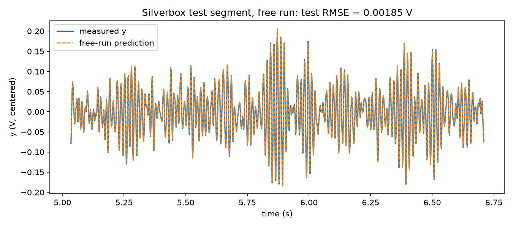

# Silverbox neural ODE (Task 5)

A neural network predicts the acceleration of the Silverbox (Duffing) oscillator from
`(y, v, u)`. The state `(y, v)` is integrated with RK4 at `dt = 1/610.35 s`, driven by
the measured input `u`:

    y' = v,   v' = alpha_theta(y, v, u)

Data: slice `[42650:46746]` of `SNLS80mV.mat` (V1 = u, V2 = y), `u` and `y` centered by
their mean on the slice. First 3072 samples = train, last 1024 = test.

## Files
| File | What it does |
|---|---|
| `data.py` | Loads the slice, centers `u` and `y`, finite-difference velocity, constants. `python data.py` prints sanity statistics. |
| `silverbox_pinn.py` | Network, RK4, window training, free-run metric. One run per call; appends a line to `results.jsonl`, saves `runs/<name>.npz` (prediction) and `runs/<name>.pt` (weights). |
| `sweep1.sh`, `sweep2.sh` | The 12-run architecture sweep and the 9-run seed-robustness sweep. |
| `plot_best.py` | Measured vs predicted plot (with error panel) for any saved run. |
| `make_table.py` | Builds `results_table.csv` / `results_table.md` from `results.jsonl`. |
| `make_final_plot.py` | Builds `final_test_plot.png` for the chosen model. |
| `results.jsonl`, `results_table.*` | All 21 runs. |
| `logs/` | Training logs of both sweeps. |

## Data
The data file is not in this repository. Download `SNLS80mV.mat` from
https://www.nonlinearbenchmark.org/ (Silverbox benchmark, Wigren and Schoukens, ECC 2013)
and place it in the repository root.

## Install and run
    python -m venv venv && venv/bin/pip install -r requirements.txt
    venv/bin/python data.py
    venv/bin/python silverbox_pinn.py '<json config>'

Config keys (defaults): `name`, `width` (64), `depth` (3), `act` (tanh|silu|gelu|relu),
`skip` (false), `phys_init` (false), `opt` (adam|adamw|rmsprop), `lr` (3e-3),
`lr_final` (1e-4, cosine decay), `steps` (3000), `win` (64), `win_final` (null =
fixed window, else linear curriculum), `batch` (64), `seed` (0), `clip` (1.0).

## Chosen model (a12, seed 0)
Tanh MLP, 3 hidden layers of 64 units, plus a linear skip path initialised as a
70 Hz oscillator; window length grows from 32 to 256 during training; Adam, 4000 steps.
8644 parameters.

    venv/bin/python silverbox_pinn.py '{"name":"a12_seed0","act":"tanh","width":64,"depth":3,"skip":true,"phys_init":true,"opt":"adam","lr":0.003,"lr_final":0.0001,"steps":4000,"win":32,"win_final":256,"batch":64,"seed":0}'

## Results (free run from sample 0 through train and test, no reset, `y` never read after sample 0)
| | train RMSE | test RMSE |
|---|---|---|
| chosen model (a12, seed 0) | 0.00147 V | 0.00185 V |
| zero prediction (baseline) | - | 0.0605 V |

Seed spread (seeds 0, 1, 2, mean +- std, test RMSE): a12 0.00157 +- 0.00025 V,
a07 (same but fixed window 64) 0.00161 +- 0.00022 V, a04 (SiLU, no skip) 0.00228 +- 0.00008 V.
a12 and a07 are not distinguishable on test RMSE; a04 is consistently somewhat worse.

Caveat: configurations were compared, and the model chosen, using the test RMSE, as the
assignment specifies, so the reported test number is slightly optimistic.

